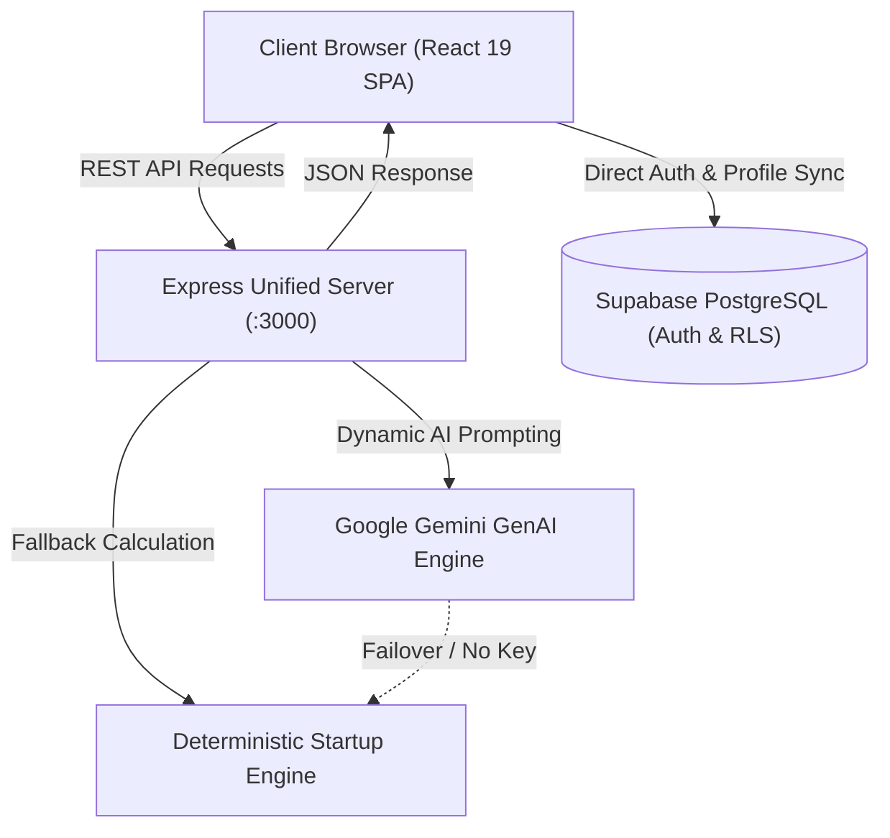

# 🚀 BizzNova — AI Founder Operating System

> **Eliminating Startup Mortality Through Deterministic Intelligence & Venture-Scale Execution.**  
> BizzNova is an end-to-end, deterministic intelligence platform and multi-stakeholder operating system designed to guide founders, team members, mentors, and investors from idea conception to venture-scale execution.

---

## 📚 Dedicated Architectural Documentation

For specialized, deep-dive technical documentation on specific subsystems, please refer to:

- 🖥️ **[Frontend Architecture & Component Guide (FRONTEND.md)](file:///c:/Users/ASUS/OneDrive/Desktop/BizzNOVAR/biznova/FRONTEND.md)**: Complete breakdown of React 19, Tailwind CSS v4, Context lifecycle, all 22 pages, UI components, and client-side scoring engines.
- ⚙️ **[Backend Architecture & API Specification (BACKEND.md)](file:///c:/Users/ASUS/OneDrive/Desktop/BizzNOVAR/biznova/BACKEND.md)**: Express runtime, Google Gemini GenAI SDK, fallback cascades, REST endpoints, Supabase PostgreSQL RLS, triggers, and deployment.
- 📑 **[Presentation & Product Requirements Document (PRESENTATION_PRD.md)](file:///c:/Users/ASUS/OneDrive/Desktop/BizzNOVAR/biznova/PRESENTATION_PRD.md)**: 12-slide executive investor pitch blueprint, dual-engine AI design, and stage evaluation criteria.

---

## 📋 Table of Contents
1. [Platform Overview & Dual-Engine Architecture](#1-platform-overview--dual-engine-architecture)
2. [Complete Project Structure](#2-complete-project-structure)
3. [Exhaustive File Catalog: Which File Contains What and Why](#3-exhaustive-file-catalog-which-file-contains-what-and-why)
   - [Root Configuration & Scripts](#31-root-configuration--scripts)
   - [Backend & Database Layer](#32-backend--database-layer)
   - [Frontend Core & Entrypoint](#33-frontend-core--entrypoint)
   - [UI Components (`src/components/`)](#34-ui-components-srccomponents)
   - [State Management & Contexts (`src/context/`)](#35-state-management--contexts-srccontext)
   - [Services & Scoring Algorithms (`src/services/`)](#36-services--scoring-algorithms-srcservices)
   - [TypeScript Contracts (`src/types/`)](#37-typescript-contracts-srctypes)
   - [Mock Data & Demo Fixtures (`src/data/`)](#38-mock-data--demo-fixtures-srcdata)
   - [All 22 Feature Pages (`src/pages/`)](#39-all-22-feature-pages-srcpages)
   - [Static Assets (`public/`)](#310-static-assets-public)
4. [Role-Based Access Control (RBAC) Matrix](#4-role-based-access-control-rbac-matrix)
5. [Demo Credentials & 1-Click Login](#5-demo-credentials--1-click-login)
6. [Quick Start & Setup Guide](#6-quick-start--setup-guide)
7. [Database Setup & Supabase Configuration](#7-database-setup--supabase-configuration)
8. [Troubleshooting & FAQ](#8-troubleshooting--faq)

---

## 1. Platform Overview & Dual-Engine Architecture

Conventional startup advisory tools suffer from **hallucinatory cheerleading**—telling every founder their idea is revolutionary. BizzNova operates on a **Deterministic Intelligence Engine**: a mathematically rigorous, evidence-based system combining generative AI with transparent diagnostic formulas.



---

## 2. Complete Project Structure

```
biznova/
├── .env                              # Environment configuration (Keys, Ports)
├── .env.example                      # Template environment variables
├── .gitignore                        # Git exclusion rules
├── BACKEND.md                        # Exhaustive backend & API technical documentation
├── FRONTEND.md                       # Exhaustive frontend & UI technical documentation
├── PRESENTATION_PRD.md               # 12-Slide Pitch Deck Blueprint & Executive PRD
├── README.md                         # Master repository guide (This file)
├── bun.lock                          # Bun package manager lockfile
├── index.html                        # Application HTML entry document
├── metadata.json                     # AI Studio runtime metadata
├── package-lock.json                 # NPM dependency lockfile
├── package.json                      # Project manifest, scripts, and dependencies
├── server.ts                         # Express server, Vite middleware & AI endpoints
├── setup-database.mjs                # Node automated database setup migration script
├── supabase_setup.sql                # Complete Supabase schema, RLS policies & triggers
├── tsconfig.json                     # TypeScript compiler configuration
├── vite.config.ts                    # Vite bundler plugins and path aliases
│
├── public/                           # Static assets served at root
│   ├── audio/
│   │   └── voiceover.mp3             # Presentation voiceover narration track
│   └── frames/                       # 300 sequential animation frames for 3D scrubber
│       ├── frame_000001.png
│       └── ... (frame_000002 to frame_000300.png)
│
├── src/                              # Frontend source code
│   ├── App.tsx                       # Root routing guard and layout orchestrator
│   ├── index.css                     # Global design tokens, cyber grid, animations
│   ├── main.tsx                      # React DOM mount bootstrap
│   │
│   ├── components/                   # Reusable UI component tree
│   │   ├── 3d/
│   │   │   └── GlowingIntelligenceCore.tsx # Interactive 3D neural core visualization
│   │   ├── common/
│   │   │   └── ToastContainer.tsx    # Animated global feedback notifications
│   │   └── layout/
│   │       ├── Header.tsx            # Sticky top bar, startup picker, role switcher
│   │       ├── Sidebar.tsx           # Multi-role filtered navigation drawer
│   │       └── StartupModal.tsx      # Modal for creating and editing startup profiles
│   │
│   ├── context/                      # React context providers
│   │   ├── AppContext.tsx            # Global state (startups, tasks, active tabs)
│   │   └── AuthContext.tsx           # Supabase auth session lifecycle & user profile
│   │
│   ├── data/
│   │   └── mockData.ts               # Resilient seed data for offline demo mode
│   │
│   ├── pages/                        # 22 Dedicated feature views
│   │   ├── AccountSettingsPage.tsx   # Profile management and password updates
│   │   ├── AdminPage.tsx             # Master administrator console & telemetry
│   │   ├── AiInsightsPage.tsx        # High-level AI strategic recommendations
│   │   ├── BusinessModelPage.tsx     # Lean canvas and interactive revenue simulator
│   │   ├── CompetitorIntelligencePage.tsx # Competitor grid & 2x2 positioning matrix
│   │   ├── CustomerPersonasPage.tsx  # Ideal Customer Profile (ICP) builder
│   │   ├── DashboardPage.tsx         # Central executive control cockpit
│   │   ├── FundingReadinessPage.tsx  # VC readiness radar & 12-slide pitch builder
│   │   ├── GrowthAnalyticsPage.tsx   # Cohort charts & autonomous turnaround diagnostics
│   │   ├── IdeaAnalyzerPage.tsx      # 9-Factor startup concept stress-test
│   │   ├── LandingPage.tsx           # Futuristic public marketing hero view
│   │   ├── LegalGuidancePage.tsx     # Startup legal checklists (Delaware C-Corp, 83b)
│   │   ├── LoginPage.tsx             # Auth login form & 1-Click Demo role cards
│   │   ├── MarketValidationPage.tsx  # Fact/Assumption evidence tracker & interviews
│   │   ├── MvpRoadmapPage.tsx        # MoSCoW MVP feature scoping board
│   │   ├── MyStartupPage.tsx         # Startup parameter viewer & edit launcher
│   │   ├── NetworkCommunityPage.tsx  # Mentor directory, co-founder & pitch competitions
│   │   ├── OpportunityRiskRadarPage.tsx # Risk radar threat matrix & mitigations
│   │   ├── ResetPasswordPage.tsx     # Recovery link callback and password update
│   │   ├── SignupPage.tsx            # Registration portal initializing Founder profile
│   │   ├── StartupHealthPage.tsx     # 6-Pillar composite startup health scoring
│   │   └── TasksMilestonesPage.tsx   # Kanban sprint board & funding stage milestones
│   │
│   ├── services/                     # Business logic and external API clients
│   │   ├── api.ts                    # Backend client bridge with fallback resilience
│   │   ├── scoring.ts                # Deterministic mathematical calculation engines
│   │   └── supabase.ts               # Supabase client and role-safe profile queries
│   │
│   └── types/
│       └── index.ts                  # TypeScript schemas, models, and UserRole enums
│
└── supabase/
    └── migrations/
        └── 20261014_init_profiles.sql# Versioned SQL migration for profiles table & RLS
```

---

## 3. Exhaustive File Catalog: Which File Contains What and Why

### 3.1 Root Configuration & Scripts

| File | What It Contains | Why It Exists in Architecture |
| :--- | :--- | :--- |
| [`.env`](file:///c:/Users/ASUS/OneDrive/Desktop/BizzNOVAR/biznova/.env) | Port numbers, Supabase URL, Public Anon Key, and Gemini API Key. | Provides local runtime configuration without hardcoding secrets into source code. |
| [`.env.example`](file:///c:/Users/ASUS/OneDrive/Desktop/BizzNOVAR/biznova/.env.example) | Clean template of all environment variable keys with instructions. | Serves as a reference for developers onboarding or setting up CI/CD. |
| [`.gitignore`](file:///c:/Users/ASUS/OneDrive/Desktop/BizzNOVAR/biznova/.gitignore) | List of ignored directories (`node_modules`, `dist`, `.env`). | Prevents local cache, build artifacts, and secrets from entering source control. |
| [`package.json`](file:///c:/Users/ASUS/OneDrive/Desktop/BizzNOVAR/biznova/package.json) | NPM dependencies, script definitions (`dev`, `build`, `lint`), metadata. | Defines project dependencies (React 19, Tailwind CSS v4, Express, GenAI SDK). |
| [`package-lock.json`](file:///c:/Users/ASUS/OneDrive/Desktop/BizzNOVAR/biznova/package-lock.json) | Exact dependency tree hashes for NPM. | Guarantees deterministic, reproducible dependency resolution across environments. |
| [`bun.lock`](file:///c:/Users/ASUS/OneDrive/Desktop/BizzNOVAR/biznova/bun.lock) | Binary lockfile for Bun runtime users. | Enables fast dependency installation when using Bun. |
| [`tsconfig.json`](file:///c:/Users/ASUS/OneDrive/Desktop/BizzNOVAR/biznova/tsconfig.json) | TypeScript configuration (`ESNext`, strict typing, JSX preservation). | Enforces strict type verification across both server and client source trees. |
| [`vite.config.ts`](file:///c:/Users/ASUS/OneDrive/Desktop/BizzNOVAR/biznova/vite.config.ts) | Vite bundler plugins (`@vitejs/plugin-react`, `@tailwindcss/vite`) and aliases. | Controls client compilation, HMR settings, and asset resolution. |
| [`index.html`](file:///c:/Users/ASUS/OneDrive/Desktop/BizzNOVAR/biznova/index.html) | HTML5 entry document, Google Fonts preconnect, and root container. | Mounts the React application and pre-loads fonts (`Plus Jakarta Sans`, `JetBrains Mono`). |
| [`metadata.json`](file:///c:/Users/ASUS/OneDrive/Desktop/BizzNOVAR/biznova/metadata.json) | Workspace runtime identifier metadata. | Internal IDE platform configuration. |

---

### 3.2 Backend & Database Layer

| File | What It Contains | Why It Exists in Architecture |
| :--- | :--- | :--- |
| [`server.ts`](file:///c:/Users/ASUS/OneDrive/Desktop/BizzNOVAR/biznova/server.ts) | Express server bootstrap, Vite middleware mounting, Gemini AI client, and REST endpoints. | Serves as the central backend engine; handles dynamic AI evaluations and static asset delivery. |
| [`setup-database.mjs`](file:///c:/Users/ASUS/OneDrive/Desktop/BizzNOVAR/biznova/setup-database.mjs) | Node.js migration runner that executes PostgreSQL commands on Supabase via REST API. | Provides an automated 1-command setup script to provision tables, triggers, and RLS policies. |
| [`supabase_setup.sql`](file:///c:/Users/ASUS/OneDrive/Desktop/BizzNOVAR/biznova/supabase_setup.sql) | Comprehensive PostgreSQL script containing table DDL, RLS policies, and triggers. | The complete master database blueprint that can be pasted directly into Supabase SQL Editor. |
| [`supabase/migrations/20261014_init_profiles.sql`](file:///c:/Users/ASUS/OneDrive/Desktop/BizzNOVAR/biznova/supabase/migrations/20261014_init_profiles.sql) | Versioned migration file for `public.profiles` schema and recursive-safe RLS. | Supports version-controlled database migrations with the Supabase CLI. |

---

### 3.3 Frontend Core & Entrypoint

| File | What It Contains | Why It Exists in Architecture |
| :--- | :--- | :--- |
| [`src/main.tsx`](file:///c:/Users/ASUS/OneDrive/Desktop/BizzNOVAR/biznova/src/main.tsx) | React 19 `createRoot` DOM mounting call. | Initializes the virtual DOM and bootstraps the top-level React tree. |
| [`src/App.tsx`](file:///c:/Users/ASUS/OneDrive/Desktop/BizzNOVAR/biznova/src/App.tsx) | Tab-based router, authentication guards, ambient glow layout, and header/sidebar shell. | Acts as the main conductor; verifies route permissions and renders active modules. |
| [`src/index.css`](file:///c:/Users/ASUS/OneDrive/Desktop/BizzNOVAR/biznova/src/index.css) | Tailwind CSS v4 setup, cyber grid patterns, keyframe animations, custom scrollbar. | Defines the futuristic aesthetic and visual identity of the operating system. |

---

### 3.4 UI Components (`src/components/`)

| File | What It Contains | Why It Exists in Architecture |
| :--- | :--- | :--- |
| [`src/components/layout/Header.tsx`](file:///c:/Users/ASUS/OneDrive/Desktop/BizzNOVAR/biznova/src/components/layout/Header.tsx) | Top navigation bar with active startup switcher, system status indicator, 1-click role switcher, notifications, and profile menu. | Gives users quick access to switch active startups, inspect system status, and switch roles for testing. |
| [`src/components/layout/Sidebar.tsx`](file:///c:/Users/ASUS/OneDrive/Desktop/BizzNOVAR/biznova/src/components/layout/Sidebar.tsx) | Left navigation dock with categorized tabs, startup stage badge, health gauge, and role filtering. | Houses the main navigation; dynamically hides tabs restricted by RBAC. |
| [`src/components/layout/StartupModal.tsx`](file:///c:/Users/ASUS/OneDrive/Desktop/BizzNOVAR/biznova/src/components/layout/StartupModal.tsx) | Full-screen multi-field modal for creating or editing startup parameters. | Allows founders to update startup metrics, stage, problem/solution, and financial figures. |
| [`src/components/3d/GlowingIntelligenceCore.tsx`](file:///c:/Users/ASUS/OneDrive/Desktop/BizzNOVAR/biznova/src/components/3d/GlowingIntelligenceCore.tsx) | Animated 3D visual component with concentric orbital rings and energy particles. | Visually symbolizes the AI/deterministic computation brain on landing and analysis views. |
| [`src/components/common/ToastContainer.tsx`](file:///c:/Users/ASUS/OneDrive/Desktop/BizzNOVAR/biznova/src/components/common/ToastContainer.tsx) | Toast container rendering animated feedback alerts with auto-dismiss timers. | Provides non-intrusive confirmation or error messages for user actions. |

---

### 3.5 State Management & Contexts (`src/context/`)

| File | What It Contains | Why It Exists in Architecture |
| :--- | :--- | :--- |
| [`src/context/AuthContext.tsx`](file:///c:/Users/ASUS/OneDrive/Desktop/BizzNOVAR/biznova/src/context/AuthContext.tsx) | Supabase auth lifecycle, session persistence, user profile synchronization, password reset handling. | Centralizes user authentication and guarantees profile state is available throughout the tree. |
| [`src/context/AppContext.tsx`](file:///c:/Users/ASUS/OneDrive/Desktop/BizzNOVAR/biznova/src/context/AppContext.tsx) | Global application state: active startup, user role, active tab, tasks, personas, competitors, toasts. | Eliminates prop-drilling; manages all startup operational data and entity mutations. |

---

### 3.6 Services & Scoring Algorithms (`src/services/`)

| File | What It Contains | Why It Exists in Architecture |
| :--- | :--- | :--- |
| [`src/services/api.ts`](file:///c:/Users/ASUS/OneDrive/Desktop/BizzNOVAR/biznova/src/services/api.ts) | HTTP client methods for `/api/system/status`, `/api/ai/analyze-idea`, and `/api/ai/diagnose-failure`. | Bridges client UI to backend endpoints with automatic client-side fallback if the server is offline. |
| [`src/services/scoring.ts`](file:///c:/Users/ASUS/OneDrive/Desktop/BizzNOVAR/biznova/src/services/scoring.ts) | Mathematical scoring algorithms (Market Opportunity, Startup Health, 9-Factor Evaluation, Revenue Simulator). | Provides zero-latency deterministic computations without external API dependencies. |
| [`src/services/supabase.ts`](file:///c:/Users/ASUS/OneDrive/Desktop/BizzNOVAR/biznova/src/services/supabase.ts) | Supabase client instance, config validation, safe profile fetch and upsert with role escalation prevention. | Handles all database operations through the Supabase client library with security checks. |

---

### 3.7 TypeScript Contracts (`src/types/`)

| File | What It Contains | Why It Exists in Architecture |
| :--- | :--- | :--- |
| [`src/types/index.ts`](file:///c:/Users/ASUS/OneDrive/Desktop/BizzNOVAR/biznova/src/types/index.ts) | TypeScript interfaces for `UserRole`, `Startup`, `StartupMetrics`, `Task`, `CustomerPersona`, `IdeaAnalysis`, etc. | Enforces data integrity across the entire codebase. |

---

### 3.8 Mock Data & Demo Fixtures (`src/data/`)

| File | What It Contains | Why It Exists in Architecture |
| :--- | :--- | :--- |
| [`src/data/mockData.ts`](file:///c:/Users/ASUS/OneDrive/Desktop/BizzNOVAR/biznova/src/data/mockData.ts) | Pre-seeded sample startups, competitors, personas, tasks, milestones, mentors, and pitch decks. | Ensures the application is immediately usable for presentations even when offline. |

---

### 3.9 All 22 Feature Pages (`src/pages/`)

| Page File | What It Contains | Why It Exists in Architecture |
| :--- | :--- | :--- |
| [`LandingPage.tsx`](file:///c:/Users/ASUS/OneDrive/Desktop/BizzNOVAR/biznova/src/pages/LandingPage.tsx) | Marketing hero, feature showcases, 3D neural core, testimonials, and auth call-to-actions. | Public entry view welcoming prospective founders and stakeholders. |
| [`LoginPage.tsx`](file:///c:/Users/ASUS/OneDrive/Desktop/BizzNOVAR/biznova/src/pages/LoginPage.tsx) | Email/password sign-in form and 1-Click Demo role cards. | Authenticates users and provides 1-click evaluation access. |
| [`SignupPage.tsx`](file:///c:/Users/ASUS/OneDrive/Desktop/BizzNOVAR/biznova/src/pages/SignupPage.tsx) | New user registration form with automatic profile initialization. | Onboards new founders onto the platform. |
| [`ResetPasswordPage.tsx`](file:///c:/Users/ASUS/OneDrive/Desktop/BizzNOVAR/biznova/src/pages/ResetPasswordPage.tsx) | Password recovery callback form for updating credentials. | Secure self-service recovery for forgotten passwords. |
| [`AccountSettingsPage.tsx`](file:///c:/Users/ASUS/OneDrive/Desktop/BizzNOVAR/biznova/src/pages/AccountSettingsPage.tsx) | Name editor, email verification badge, role indicator, and password changer. | Allows users to maintain their profile information. |
| [`DashboardPage.tsx`](file:///c:/Users/ASUS/OneDrive/Desktop/BizzNOVAR/biznova/src/pages/DashboardPage.tsx) | Executive cockpit displaying health gauge, runway, revenue, and role-specific action widgets. | Primary operational homepage providing an instant overview of startup vitals. |
| [`MyStartupPage.tsx`](file:///c:/Users/ASUS/OneDrive/Desktop/BizzNOVAR/biznova/src/pages/MyStartupPage.tsx) | Deep-dive summary of active startup identity, financials, and edit triggers. | Detailed view of the current startup's operational parameters. |
| [`AiInsightsPage.tsx`](file:///c:/Users/ASUS/OneDrive/Desktop/BizzNOVAR/biznova/src/pages/AiInsightsPage.tsx) | High-level strategic briefing synthesizing metrics into actionable sprint priorities. | Delivers strategic clarity to founders and advisory boards. |
| [`IdeaAnalyzerPage.tsx`](file:///c:/Users/ASUS/OneDrive/Desktop/BizzNOVAR/biznova/src/pages/IdeaAnalyzerPage.tsx) | 9-Factor startup concept stress-testing engine with structured factor scores and validation experiments. | Evaluates startup viability before significant capital or engineering hours are spent. |
| [`MarketValidationPage.tsx`](file:///c:/Users/ASUS/OneDrive/Desktop/BizzNOVAR/biznova/src/pages/MarketValidationPage.tsx) | Evidence tagging board (Fact, Assumption, Hypothesis) and customer discovery interview logger. | Prevents confirmation bias by systematically validating assumptions with real users. |
| [`CompetitorIntelligencePage.tsx`](file:///c:/Users/ASUS/OneDrive/Desktop/BizzNOVAR/biznova/src/pages/CompetitorIntelligencePage.tsx) | Competitor grid with pricing, strengths, weaknesses, and interactive 2x2 positioning matrix. | Maps market positioning to uncover defensible whitespace against incumbents. |
| [`CustomerPersonasPage.tsx`](file:///c:/Users/ASUS/OneDrive/Desktop/BizzNOVAR/biznova/src/pages/CustomerPersonasPage.tsx) | Ideal Customer Profile (ICP) manager with pain points, buying triggers, and budget authority. | Clarifies target audience personas for marketing and sales focus. |
| [`OpportunityRiskRadarPage.tsx`](file:///c:/Users/ASUS/OneDrive/Desktop/BizzNOVAR/biznova/src/pages/OpportunityRiskRadarPage.tsx) | Threat matrix categorized across Market, Technical, Financial, and Regulatory domains. | Preempts existential startup risks before they materialize into failures. |
| [`BusinessModelPage.tsx`](file:///c:/Users/ASUS/OneDrive/Desktop/BizzNOVAR/biznova/src/pages/BusinessModelPage.tsx) | 9-Box Lean Canvas and interactive 12-month compounding revenue simulator. | Models unit economics and projects runway, cash burn, and break-even points. |
| [`MvpRoadmapPage.tsx`](file:///c:/Users/ASUS/OneDrive/Desktop/BizzNOVAR/biznova/src/pages/MvpRoadmapPage.tsx) | MoSCoW feature prioritization board and MVP release timeline. | Prevents feature bloat by strictly scoping the initial release. |
| [`TasksMilestonesPage.tsx`](file:///c:/Users/ASUS/OneDrive/Desktop/BizzNOVAR/biznova/src/pages/TasksMilestonesPage.tsx) | Kanban sprint board and macro milestone timeline tied to funding stages. | Connects daily team task execution to long-term funding milestones. |
| [`GrowthAnalyticsPage.tsx`](file:///c:/Users/ASUS/OneDrive/Desktop/BizzNOVAR/biznova/src/pages/GrowthAnalyticsPage.tsx) | Cohort charts, churn analytics, and autonomous turnaround diagnostic playbooks. | Diagnoses stagnation and prescribes concrete 72-hour turnaround experiments. |
| [`StartupHealthPage.tsx`](file:///c:/Users/ASUS/OneDrive/Desktop/BizzNOVAR/biznova/src/pages/StartupHealthPage.tsx) | 6-Pillar health audit breakdown (Market, Product, Runway, Team, Traction, Moat). | Provides a venture-grade audit score of the company's overall operational health. |
| [`FundingReadinessPage.tsx`](file:///c:/Users/ASUS/OneDrive/Desktop/BizzNOVAR/biznova/src/pages/FundingReadinessPage.tsx) | Investor readiness radar, valuation/dilution calculator, and 12-slide pitch deck builder. | Prepares founders for institutional fundraising and angel presentations. |
| [`NetworkCommunityPage.tsx`](file:///c:/Users/ASUS/OneDrive/Desktop/BizzNOVAR/biznova/src/pages/NetworkCommunityPage.tsx) | Filterable mentor directory, co-founder talent matching, and global competition tracker. | Connects founders with advisors, talent, and grant opportunities. |
| [`LegalGuidancePage.tsx`](file:///c:/Users/ASUS/OneDrive/Desktop/BizzNOVAR/biznova/src/pages/LegalGuidancePage.tsx) | Legal checklists covering Delaware C-Corp formation, 83(b) tax elections, IP assignment, and SAFEs. | Helps early-stage founders avoid costly legal and equity structuring mistakes. |
| [`AdminPage.tsx`](file:///c:/Users/ASUS/OneDrive/Desktop/BizzNOVAR/biznova/src/pages/AdminPage.tsx) | Platform administration console with system telemetry, user counts, and role assignment. | Exclusive master control room for system operators and platform admins. |

---

### 3.10 Static Assets (`public/`)

| File / Folder | What It Contains | Why It Exists in Architecture |
| :--- | :--- | :--- |
| [`public/audio/voiceover.mp3`](file:///c:/Users/ASUS/OneDrive/Desktop/BizzNOVAR/biznova/public/audio/voiceover.mp3) | High-quality synthesized presentation voiceover narration track. | Delivers narrated walkthroughs during executive pitches and demo runs. |
| [`public/frames/`](file:///c:/Users/ASUS/OneDrive/Desktop/BizzNOVAR/biznova/public/frames) | 300 sequential animation frames (`frame_000001.png` to `frame_000300.png`). | Enables smooth 3D interactive scrubbing on the landing presentation hero. |

---

## 4. Role-Based Access Control (RBAC) Matrix

BizzNova tailors the user experience across 5 dedicated roles:

```
┌──────────────────────────────┬─────────┬──────────────┬────────┬──────────┬───────┐
│ Feature / Module             │ FOUNDER │ TEAM MEMBER  │ MENTOR │ INVESTOR │ ADMIN │
├──────────────────────────────┼─────────┼──────────────┼────────┼──────────┼───────┤
│ Executive Dashboard          │   ✅    │      ✅      │   ✅   │    ✅    │  ✅   │
│ My Startup Profile           │   ✅    │      ✅      │   ❌   │    ❌    │  ✅   │
│ AI Strategic Insights        │   ✅    │      ❌      │   ✅   │    ✅    │  ✅   │
│ Idea Analyzer & Score        │   ✅    │      ❌      │   ✅   │    ❌    │  ✅   │
│ Market Validation            │   ✅    │      ❌      │   ✅   │    ❌    │  ✅   │
│ Competitor Intelligence      │   ✅    │      ❌      │   ❌   │    ✅    │  ✅   │
│ Customer Personas            │   ✅    │      ❌      │   ❌   │    ❌    │  ✅   │
│ Opportunity & Risk Radar     │   ✅    │      ❌      │   ❌   │    ✅    │  ✅   │
│ Business Model & Simulator   │   ✅    │      ❌      │   ❌   │    ✅    │  ✅   │
│ MVP Builder & Roadmap        │   ✅    │      ✅      │   ❌   │    ❌    │  ✅   │
│ Tasks & Milestones           │   ✅    │      ✅      │   ❌   │    ❌    │  ✅   │
│ Startup Health Score         │   ✅    │      ❌      │   ❌   │    ✅    │  ✅   │
│ Growth & Failure Diagnostics │   ✅    │      ❌      │   ❌   │    ✅    │  ✅   │
│ Funding Readiness & Deck     │   ✅    │      ❌      │   ❌   │    ✅    │  ✅   │
│ Network & Community          │   ✅    │      ❌      │   ✅   │    ❌    │  ✅   │
│ Legal & Compliance Guidance  │   ✅    │      ❌      │   ❌   │    ❌    │  ✅   │
│ Admin Console (/admin)       │   ❌    │      ❌      │   ❌   │    ❌    │  ✅   │
└──────────────────────────────┴─────────┴──────────────┴────────┴──────────┴───────┘
```

---

## 5. Quick Demo Access

On the Login page (`/login`), click **"Quick Demo Login (Select Role)"** to preview the interface for a role. This local preview does not authenticate a Supabase user.

---

## 6. Quick Start & Setup Guide

### 1. Prerequisites
- **Node.js**: `v18.0.0` or higher
- **npm**, **pnpm**, or **bun**

### 2. Installation
```bash
git clone <repository_url>
cd biznova
npm install
```

### 3. Environment Configuration
Verify or edit `.env` in the project root:
```env
PORT=3000
VITE_SUPABASE_URL=https://txbxrppepxyfqmtgxkfd.supabase.co
VITE_SUPABASE_ANON_KEY=eyJhbGciOi...
GEMINI_API_KEY=
```

### 4. Start Development Server
```bash
npm run dev
```
Open **[http://localhost:3000](http://localhost:3000)** in your browser.

### 5. Type Checking & Production Build
```bash
# Run TypeScript type check
npm run lint

# Build production bundle
npm run build

# Start production server
npm start
```

---

## 7. Database Setup & Supabase Configuration

All database definitions are packaged in [`supabase_setup.sql`](file:///c:/Users/ASUS/OneDrive/Desktop/BizzNOVAR/biznova/supabase_setup.sql).

### Steps to Apply:
1. Open the **[Supabase Project SQL Editor](https://supabase.com/dashboard/project/txbxrppepxyfqmtgxkfd/sql/new)**.
2. Copy the contents of [`supabase_setup.sql`](file:///c:/Users/ASUS/OneDrive/Desktop/BizzNOVAR/biznova/supabase_setup.sql), paste into the editor, and click **Run**.
3. **What this executes:**
   - Creates the `public.profiles` table linked to `auth.users(id)`.
   - Enables Row Level Security (RLS) with recursive-safe `is_admin()` policy checking.
   - Installs the `handle_new_user()` trigger to automatically create a profile when a new user signs up.
   - Installs the `set_user_role(email, role)` helper function.

### Assigning Roles in Supabase:
```sql
SELECT set_user_role('founder@bizznova.demo',  'FOUNDER');
SELECT set_user_role('team_member@bizznova.demo', 'TEAM_MEMBER');
SELECT set_user_role('mentor@bizznova.demo',    'MENTOR');
SELECT set_user_role('investor@bizznova.demo',  'INVESTOR');
SELECT set_user_role('admin@bizznova.demo',     'ADMIN');
```

---

## 8. Troubleshooting & FAQ

#### Q: How do I switch roles while testing the interface?
- **Option 1**: Log out and use the 1-Click Demo buttons on the Login page.
- **Option 2**: In the dashboard header, click the role badge button to test-switch roles on the fly without logging out.

#### Q: Getting "infinite recursion in policy for relation profiles"?
- Run the SQL in [`supabase_setup.sql`](file:///c:/Users/ASUS/OneDrive/Desktop/BizzNOVAR/biznova/supabase_setup.sql). The `is_admin()` `SECURITY DEFINER` function completely solves PostgreSQL RLS recursion.

#### Q: Can I run this offline without internet or an API key?
- **Yes.** If Supabase is unreachable or `GEMINI_API_KEY` is not provided, BizzNova automatically activates local Demo Mode with full feature access and transparent deterministic scoring models for all roles.
